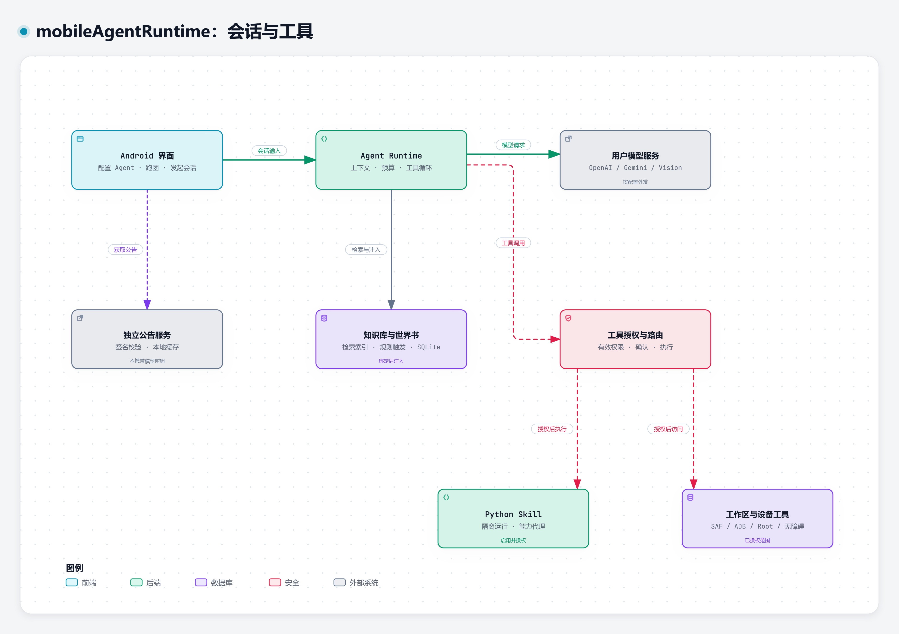

<!-- SPDX-FileCopyrightText: 2026 mobileAgentRuntime contributors -->
<!-- SPDX-License-Identifier: AGPL-3.0-only -->

# mobileAgentRuntime

mobileAgentRuntime 是运行在 Android 上的本地 Agent 工作台。你可以接入自己的大模型 API，按任务组合系统提示词与知识库，挂载世界书、角色卡和 Python 技能，或调用工作区与设备工具处理文档、读写代码并主持跑团（TRPG）战役。

应用在设备本地保存配置与会话历史，同时托管知识库、世界书和检索索引。默认向量化（ONNX Embedding）在手机端离线运行；聊天推理与视觉解析，以及可选的 API Embedding 和联网搜索，均直连你配置的服务商。



架构图由 [Archify](https://github.com/tt-a1i/archify) 生成，展示单次会话与工具调用的执行路径，复现方式见[图表说明](docs/diagrams/README.md)。

## 功能概览

| 场景 | 可用能力 |
| --- | --- |
| 多协议模型接入 | 支持 OpenAI Chat Completions、OpenAI Responses、Google AI Studio 与 Vertex AI Express 原生接口，兼容各类 HTTPS/HTTP 反代网关 |
| 多模态对话 | 支持发送文字与图片（单条消息最多 8 张），提供自动上下文压缩、运行预算控制、会话归档与完整 ZIP 备份 |
| 角色卡与世界书 | 导入 Tavern v1 与 Character Card v2/v3（JSON/PNG），批量导入并管理世界书，支持关键词、正则、递归激活与离线触发测试 |
| 跑团模式（TRPG） | 专用桌面跑团界面，内置 D&D 与 CoC 7 版数值框架、复合骰子与检定卡、团务日志、队伍背包、地点地图、检查点分支与本机氛围媒体 |
| 本地知识库 | 导入文档、文件夹或 ZIP，对图片与扫描页执行多模态视觉解析，通过本地 SQLite FTS5 与 USearch 向量混合检索返回带出处的引用 |
| 技能（Skills） | 导入以 `SKILL.md` 为入口的技能包，支持纯指令技能，并在 Android 隔离 CPython 3.14 运行时中执行兼容的 Python 脚本与标准库 CLI |
| 工作区与设备工具 | 在应用私有目录、SAF 授权文件夹、ADB 特权目录或 Root 目录中读写文件、搜索代码与应用补丁，支持 Shizuku、有线常驻 ADB、Root 与无障碍辅助 |
| 联网、MCP 与诊断 | 集成 Brave、Tavily、Exa 搜索及 DeepSeek 搜索与网页抓取，支持远程 HTTP MCP 工具绑定，提供请求检查器与脱敏诊断包导出 |

## 快速上手

### 安装与更新

- **系统要求**：Android 8.0（API 26）及以上。正式发行包面向 `arm64-v8a` 设备，Debug 与 Review 构建额外包含 `x86_64` 以支持模拟器。
- **获取安装包**：从 [GitHub Releases](https://github.com/hedanbaomi/mobile-agent-runtime/releases) 下载最新正式版 APK（当前最新稳定版为 `v1.5.0`），或参照下文[构建](#构建)章节从源码打包。
- **应用内更新**：应用在前台运行时每小时自动检查 GitHub 正式版更新，也可在**设置 → 关于**中手动检查。点击“下载并安装”后，应用会在校验文件哈希与签名后拉起系统安装界面；更新机制详见[更新说明](docs/APP_UPDATES.md)。

全局导航菜单汇集了全部功能入口，包括**对话**、**智能体**、**服务商**、**知识**、**世界书**、**技能**、**公告**、**设置**、**MCP** 和**请求检查器**。手机端点击左上角菜单按钮或从侧边滑出抽屉，平板与宽屏窗口使用常驻侧栏。

Debug/Review 构建与正式发行包使用不同签名。首次在两者之间切换前，请先在**设置 → 数据与备份**中导出所需数据，卸载旧包后再安装新包。发布规范与附件校验方式见[发布文档](docs/RELEASING.md)。

### 开启第一段对话

1. 进入**服务商**，新建服务商并填写 API 格式、Base URL 与 API Key，接着添加一个 `CHAT` 角色的模型配置。
2. 选中刚添加的模型，点击**测试连接**验证连通性。若后续需要使用图片输入或工具调用，可再点击**能力探测**（探测会发起一次真实请求）。
3. 进入**智能体**，新建 Agent（日常问答与工具任务选择普通模式，桌面角色扮演选择跑团模式），选定 Chat 模型并编写系统提示词后保存。
4. 回到**对话**页面，选择该 Agent 新建会话，即可发送文字或附图开始交流。
5. 需要结合本地资料、世界书或文件目录时，回到智能体编辑页绑定对应资源，新建会话即可使用新配置。

新建会话时会保存一份当前 Agent 的配置快照。后续修改 Agent 的模型、提示词或默认工作区，只会作用于新创建的会话，不会打乱已有会话的上下文；而撤销权限、停用技能或关闭联网搜索会立即对所有会话生效。在会话列表中长按某条对话可将它归档，后续可在**设置 → 数据与备份 → 已归档的对话**中查看或恢复。

## 配置服务商与模型

### 协议格式与端点

| API 格式 | 请求方式 | 适用服务 |
| --- | --- | --- |
| OpenAI-compatible | `POST /chat/completions` | OpenAI 及兼容 Chat Completions 协议的服务商与反代网关 |
| OpenAI Responses | `POST /responses` | 支持 Responses 协议、对应输入格式与事件流的服务端 |
| Google AI Studio | 原生 `generateContent` / `streamGenerateContent` | Google AI Studio 官方接口，默认地址 `https://generativelanguage.googleapis.com/v1beta` |
| Google Vertex AI Express | 原生 `generateContent` / `streamGenerateContent` | Google Cloud Vertex Express API Key 模式，需将默认地址中的 `PROJECT_ID` 替换为实际项目 ID |

填写 OpenAI 兼容或 Responses 地址时，输入服务商给出的 API 基础前缀（如 `https://api.example.com/v1` 或 `https://api.deepseek.com`），应用会自动拼接 `/chat/completions`、`/responses` 或 `/embeddings`，不会强行插入 `/v1`。接入 One API 或 New API、LiteLLM、CLIProxyAPI 等自建反代时，支持自定义端口与路径前缀，也可连接局域网 HTTP 地址。Google AI Studio 与 Vertex Express 走原生 Gemini 协议，直接填写 `gemini-...` 或 `google/gemini-...` 等模型名称即可，支持原生图文输入、工具调用与思考签名续轮。

### 图片输入、上下文与请求检查器

- **聊天附图与多模态**：会话绑定的 Chat 模型开启图片能力后，点击聊天输入框旁的图片按钮即可从系统相册选择最多 8 张图片（支持 PNG/JPEG/GIF/WebP，单张不超过 2 MiB），可配文字或单独发送图片。知识库导入中的图片解析同样复用具备图片能力的 Chat 模型，API Embedding 则通过独立的 `EMBEDDING` 角色模型配置。
- **上下文窗口与自动压缩**：上下文窗口支持自动读取服务端元数据，也可按模型规格手动指定。长对话接近输入预算、可用窗口或轮次上限时，应用会自动将早期历史压缩为可追溯摘要并继续运行，同时保留最近的上传原图与工具调用关系。
- **输出预算与参数 JSON**：输出上限可跟随服务商默认或手动指定。额外模型参数可通过参数 JSON 传入（OpenAI 协议传入标准采样字段，Google 原生协议映射至 `generationConfig`）。
- **请求检查器**：在侧栏打开**请求检查器**，可以查看当前会话实际发往模型的分层提示词、有效参数与已注册工具列表。检查器会自动隐去 API Key 等凭据，方便核对提示词拼接与排查超限问题。

## 角色卡、世界书与跑团模式

### 角色卡导入

在**智能体**页面点击**导入角色卡**，可选择 Tavern v1 或 Character Card v2/v3 格式的 `.json` 与 `.png` 文件。预览界面会展示角色设定、格式信息与兼容性提示，你可以设置玩家称呼、切换多个开场白，并勾选是否一并导入卡内嵌的世界书。确认后会生成一份可自由编辑的 Agent 草稿，选定模型并保存即可开启对话；新建会话会自动插入所选的助手开场白。

### 世界书

世界书用于按对话内容动态注入背景设定，不占用持久聊天消息，也无需建立向量索引。

1. 在**世界书**页面可直接新建，或点击**导入**批量导入多份 `.json` 文件、文件夹与 ZIP 压缩包。支持原生格式、SillyTavern World Info、Character Book 与 `lorebook_v3`，导入前可预览每个文件的识别结果并选择同名处理策略（保留两者、覆盖或跳过）。
2. 为条目设置常驻状态或触发关键词，支持次要逻辑、正则表达式（RE2/J）、递归激活、触发概率、包含组权重、持续/冷却/延迟轮数以及插入位置（角色提示词前后、指定消息深度或 `{{outlet::名称}}` 出口）。
3. 使用页面内的**离线测试**输入模拟对话文本，无需消耗模型额度即可查看条目的命中、排序与排除原因。
4. 在 Agent 编辑页绑定默认世界书，也可用对话页顶部的世界书按钮为当前会话单独开关或覆盖预算设置。发送消息后，点击对话内的**本轮使用情况**即可查看本轮实际命中的条目与预算占用。

### 跑团模式（TRPG）

新建 Agent 时将模式设为 **TRPG**，基于该 Agent 创建的对话即进入跑团工作台。

- **状态栏（HUD）与角色卡**：对话顶部提供可折叠的跑团工具栏，展示当前角色与场景摘要。点击状态板可管理规则体系（自定义、D&D 3R、D&D 5E、CoC 7 版）、玩家角色卡、队伍成员、背包物品、状态条件与先攻轮次，也可一键补充 D&D 或 CoC 常用数值项（如 HP、MP、SAN、幸运、法术位）。
- **骰盘与检定**：内置手动骰盘与模型工具（`dice_roll` 与 `random_number`）。标准骰子表达式支持 `NdM`、优势/劣势（如 `2d20kh1+7`、`4d6kh3`）与 DC 判定；CoC 7 版检定支持技能值与奖惩骰，自动计算极难成功、困难成功、大成功与大失败，并在消息流中渲染交互式检定卡与状态变更卡。
- **团务日志、地图与分支检查点**：团务面板记录检定历史、资源净变化、故事章节、任务线索与进度时钟，支持对最近一次状态改动执行撤销（Undo），并提供地点关系地图。你可以在稳定的消息边界创建**检查点**，随时从历史节点拉出新的平行分支会话，或导出过滤掉主持人隐藏信息的玩家视图资料。
- **语音与本机氛围**：支持调用系统语音输入填充草稿、使用本机已安装的离线 TTS 朗读回复，以及从本地选择背景音乐、环境音效、场景插图与地图底图（素材仅保存在本机当前会话偏好中，不会上传给模型）。

## 知识库

1. 在**知识**页面新建知识库，选择文件、文件夹或 ZIP 压缩包。支持 TXT、Markdown、PDF、DOCX、EPUB 及常见图片格式。
2. 导入包含图片、扫描页或复杂排版的文档时，选择具备图片输入能力的 Chat 模型并确认批次处理范围；若只需提取纯文本，也可显式选择接受视觉缺口继续导入。
3. 导入任务在后台分阶段完成复制暂存、文档解析、视觉处理、文本分块与向量化。在**处理限制**中可设置 1–6 个并发请求数与失败阈值，中断后重新恢复会自动复用已缓存的成功结果。
4. 知识库状态变为**就绪**后，在 Agent 配置中绑定该知识库并新建会话。提问时应用会通过本地 SQLite FTS5 全文检索与 USearch 向量检索（RRF 融合）召回相关片段，回答中的编号引用可直接定位回原文与原图。

应用默认使用内置的本地 ONNX Embedding 模型，切换聊天服务商无需重建知识库索引。如需改用远程 API Embedding，可在服务商中配置 `EMBEDDING` 角色模型并在知识库中切换向量空间。

## 技能、工作区与设备工具

### 导入与运行 Skill

在**技能**页面导入以 `SKILL.md` 为核心的技能包。你可以先审阅来源、许可证和源码文件，核对兼容性分析报告后再安装、启用并绑定到目标 Agent。

- **纯指令技能**：安装启用并绑定 Agent 后，其说明内容会按需纳入 Agent 提示词。
- **Python 与标准库 CLI 技能**：应用会自动分析包内脚本的兼容性（无需额外编写 `mobile-skill.json`，该清单仅作为可选高级扩展）。兼容的纯 Python 脚本与标准库命令行工具会在 Android 独立的 `isolatedProcess`（CPython 3.14）中运行，通过能力代理受控访问已授权的知识库、网络、模型接口或技能存储。

### 文件工作区与代码工具

在 Agent 配置中可授予多个目录授权并指定新会话的默认工作区，文件的读写、删除与补丁操作分别受独立权限控制。

| 工作区类型 | 适用场景 |
| --- | --- |
| 应用私有工作区 | 让 Agent 在应用沙盒内创建、整理和读写文件，开箱即用 |
| 系统授权文件夹（SAF） | 通过 Android 系统文件选择器授权指定外部文件夹，适合处理手机文档目录 |
| ADB 特权目录 | 经 Shizuku 或有线常驻 ADB 挂载系统级可达目录，再按需授权给 Agent |
| Root 目录 | 在已 Root 设备上经 Direct Root（`su`）或 Shizuku Root 挂载特权目录，支持完整 POSIX 文件与元数据操作 |

除基础的文件增删改查外，工作区还支持大文件分块读取（`file_stat`）与带版本校验的原子补丁（`apply_patch`），提供文件名通配搜索（`file_glob`）、字面文本搜索（`file_grep`）和有界并发批量读取（`read_batch`），并可在单次运行内管理后台任务（`job_start`、`job_output` 与 `job_cancel`）。工具调用默认需要逐次确认；你也可以在设置中开启“跳过工具运行确认”或“Root 只读免确认”以简化高频读取操作。

### Shizuku、有线常驻 ADB、Root 与无障碍辅助

日常聊天、知识问答与普通文件夹读写不需要配置以下高权限通道。需要跨目录处理系统文件、执行 Shell 命令或自动化操作手机界面时，可在**设置**中按需启用。

- **Shizuku**：在手机上启动 Shizuku 并向本应用授权，随后在应用设置中选择 Shizuku 通道。
- **有线常驻 ADB（支持拔线运行）**：从 Releases 下载配套的 `mobileAgentRuntime-vVERSION-windows-adb.zip`，在安装了 Java 17+ 与 Google Platform-Tools（`adb`）的 Windows 电脑上解压并运行 `start-wired-adb.bat`。通过 USB 连接手机并按界面提示输入一次性配对令牌完成激活后，设备端常驻服务即可接管后续请求，**退出电脑端工具并拔掉数据线后仍可继续使用**（直至手机重启或手动停止服务）。详细步骤见[有线 ADB Companion 文档](docs/plans/wired-adb-desktop-bridge.md)。
- **Root 通道（Direct `su` 与 Shizuku Root）**：面向已获取 Root 权限的设备，支持直接 `su` 握手或通过 Root 身份的 Shizuku 接入，提供独立的 Root 工作区、文件权限/属主元数据读写（`file_get_metadata` / `file_set_metadata`）与独立授权的 Root `shell_exec`。
- **Shell 命令执行（`shell_exec`）**：ADB 级通道需在设置中开启危险模式（支持高危命令确认或自主执行两档）并为 Agent 授予命令权限；Root 通道使用独立的 Root Shell 同意开关。普通 Debug 安装包默认禁用危险控制能力，从源码编译验证该流程时请使用 `:app-android:assembleReview`。
- **无障碍屏幕观察与辅助操作**：在设置中启用无障碍服务与应用内同意开关后，Agent 可通过 `device_observe` 与 `device_wait_for` 直接读取当前屏幕的结构化控件树（自动过滤密码框，比传统截图或 `uiautomator dump` 更快）。Shizuku 或有线 ADB 通道就绪后，还可进一步开启“允许辅助操作”，让 Agent 通过 `device_act` 执行控件点击、长按、文本输入、滚动以及返回/主页/最近任务导航。

### 联网搜索、网页抓取、MCP 与公告

- **联网搜索与网页抓取**：在**设置 → 联网搜索**中选择 **Brave**、**Tavily**、**Exa** 或 **DeepSeek**，填入对应 API Key 并启用（各家密钥独立加密保存，切换服务不会清空其他密钥）。随后在 **智能体 → 编辑** 中打开**允许联网搜索**并保存，会话即可直接调用 `web_search` 检索公开网页摘要；选择 DeepSeek 时还会同时启用 `web_fetch`，支持将指定公开网页正文抓取为 Markdown。详见[联网搜索说明](docs/WEB_SEARCH.md)。
- **远程 MCP**：在 **MCP** 页面配置远程 HTTP MCP 服务端地址与认证信息，执行工具发现后即可将外部工具绑定给指定 Agent。
- **公告与统计**：**公告**页面展示项目通知与版本动态，支持离线缓存且独立于模型配置；匿名统计可在设置中随时关闭。

## 排障与诊断

| 常见现象 | 排查方向 |
| --- | --- |
| 连接测试失败（401 / 404 / 超时） | 检查 Base URL 前缀、API 格式、模型 ID 与凭据；使用 Vertex Express 时确认已将 `PROJECT_ID` 替换为实际项目 ID；连接局域网反代时填写电脑局域网 IP 而非 `127.0.0.1` |
| 能正常文字聊天，但发图或工具调用失败 | 在服务商页面对该模型运行**能力探测**，确认上游渠道与模型本身支持多模态输入或原生 Function Calling |
| 提示输入预算不足或上下文溢出 | 通过**请求检查器**查看历史消息、知识库片段、世界书条目与附图占用，适当缩减单次绑定资源或调小预留输出预算 |
| 知识库导入后搜不到内容 | 查看导入批次是否已进入**就绪**状态、含图批次是否停留在等待视觉确认，以及当前会话所用的 Agent 快照是否已绑定该知识库 |
| 世界书条目未触发 | 在世界书页面使用**离线测试**输入对话文本，检查关键词、次要条件、概率或扫描深度，并在对话页打开**本轮使用情况**查看排除原因 |
| Python 技能无法运行 | 在技能详情查看兼容性分析结果，确认脚本未依赖桌面专属模块或原生扩展，并检查技能是否已启用、绑定 Agent 及授予所需能力 |
| 工作区或 Shell 工具未出现在模型工具列表中 | 检查当前会话绑定的工作区、Agent 文件/命令权限、模型工具能力，以及 Shizuku / 有线 ADB / Root 通道连接状态；源码构建测试危险模式需使用 Review 包 |

遇到难以复现的问题或使用 Root / 设备工具需要反馈 Bug 时，可在**设置**中开启**应用内诊断记录**（默认 `INFO` 级别，切换为 `DEBUG` 可记录更详细的阶段进度），复现问题后点击**导出诊断 ZIP**，连同复现步骤、构建版本与发生时间提交至 [GitHub Issues](https://github.com/hedanbaomi/mobile-agent-runtime/issues)。诊断日志会对密钥与敏感凭据做脱敏处理，机制说明见[诊断文档](docs/DIAGNOSTICS.md)。

## 构建

开发环境需要 **JDK 17**、**Android SDK 35** 与仓库自带的 Gradle Wrapper。通过 Android Studio 或根目录 `local.properties` 配置 SDK 路径；首次构建会按仓库锁定的地址与校验值自动下载原生库、CPython 运行时与本地 Embedding 模型包。

在仓库根目录执行以下命令即可构建并安装 Debug 包（Windows PowerShell 示例，macOS / Linux 将 `.\gradlew.bat` 替换为 `./gradlew`）。

```powershell
.\gradlew.bat :app-android:assembleDebug --dependency-verification=strict
adb install -r .\app-android\build\outputs\apk\debug\app-android-debug.apk
```

只针对单台真机或模拟器快速打包 Debug APK 时，可使用单 ABI 辅助脚本（跳过另一架构的原生编译）。

```sh
bash tools/dev-apk arm64-v8a
# 或面向模拟器：
bash tools/dev-apk x86_64
```

需要验证危险模式与高权限控制面时，请构建 Review 包。该包使用本地 Debug 密钥签名，但关闭了调试标志（`debuggable=false`）。

```powershell
.\gradlew.bat :app-android:assembleReview --dependency-verification=strict
adb install -r .\app-android\build\outputs\apk\review\app-android-review.apk
```

### 开发与提交前检查

日常修改后可使用 `tools/dev-check` 快速运行定向测试、许可证检查与模块边界校验。

```sh
bash tools/dev-check :data:sqlite:test '*KnowledgeDisplayQueryTest'
```

提交 Pull Request 前，请执行完整的仓库门禁与 REUSE 许可证合规检查（需安装 Python 3.11+ 与 `reuse`）。

```powershell
.\gradlew.bat licenseGuard licenseGuardReverse check verifyCiPins verifyDependencyLock verifyDependencyVerification verifyWorkflowYaml --dependency-verification=strict
python -m reuse lint
```

## 代码结构

| 目录 | 职责说明 |
| --- | --- |
| `app-android/` | Android 应用入口、依赖装配、全局导航、特权通道与宿主工具集成 |
| `feature/` | Compose 功能页面与状态管理（`chat`、`agents`、`providers`、`knowledge`、`worldbooks`、`skills`、`announcements`、`settings`） |
| `shared/` | 纯 JVM 共享模块，包含领域模型、Agent Runtime（含跑团与世界书引擎）、Provider 适配、知识契约、Skill 协议与桥接协议 |
| `data/sqlite/` | Bundled SQLite + FTS5 持久化、schema 迁移、仓储实现与索引协调 |
| `runtime/` | 平台运行时实现，涵盖本地 ONNX Embedding、USearch JNI 向量索引与 Android CPython 隔离执行 |
| `platform/android/` | Android 存储（SAF / CAS）、Keystore 安全凭据、前台导入任务与 IPC 封装 |
| `desktop/bridge/` | Windows 有线 ADB 桌面激活与配对工具（Desktop Companion） |
| `services/announcements/` | 独立公告服务 Worker、D1 存储与管理端 |
| `docs/` | 架构决策记录（ADR）、模块技术契约、UI 设计稿与验证记录 |

延伸阅读：[贡献指南](CONTRIBUTING.md) · [技术实现方案](docs/IMPLEMENTATION_PLAN.md) · [知识库契约](docs/KNOWLEDGE.md) · [Skill 与权限模型](docs/SKILLS_AND_SECURITY.md) · [验收项](docs/ACCEPTANCE.md)。

## 许可证

本项目所有第一方源代码与构建脚本，以及服务端和项目文档，均采用 **AGPL-3.0-only** 许可证。完整条款见 [LICENSE](LICENSE)，归属与合规要求见[许可证政策](LICENSE_POLICY.md)。第三方依赖与模型权重包，以及用户导入的知识库、世界书和外部 Skills，均保留各自原有许可。
